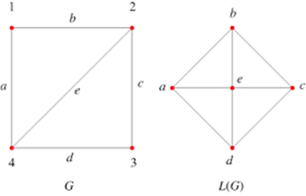

## Street networks

Until this point the focus has been on networks *between* cities. Now we are turning the focus on networks *within* cities and more specifically on street networks. These are spatial networks whose edges and not only their nodes contain spatial information. To summarise, in spatial or, in other words, geospatial networks:

-   Nodes always contain geographical coordinates.

-   However, edges can:

    -   either contain geographical information (e.g. road networks),

    -   or not, and instead just link two nodes (e.g. social networks whose node's geographical location is known to us)

The first case refers to *spatially explicit* networks, the second to *spatially implicit*.

Street network analysis is not new. For instance, Leonhard Euler proved that the [Seven Bridges of Königsberg problem](https://en.wikipedia.org/wiki/Seven_Bridges_of_K%C3%B6nigsberg) had no solution. This type of problems and analysis -- routing -- later on became integral part of the standard GIS toolkit.

Why is it important to study street networks:

-   To understand the form of cities. There are quite a few recent studies [e.g. @boeing2019urban; @boeing2017osmnx], but this was also part of an older strand of research called Space Syntax [@hillier1976space].

-   To understand the structure of transportation systems and support transportation planning.

Some key characteristics of street networks:

-   They might have multiple edges between two nodes, e.g. two different streets linking the same two junctions.

-   Street networks are approximately planar [@boeing2017osmnx]. *Approximately*, because of bridges, tunnels and underpasses. Planarity has some important consequences: a node can only have a handful of neighbours and triangles are rare. So, measures which are very informative for other types of networks, such as the clustering coefficient or the small-world property, do not tell us much about street networks.

-   Edges contain geographical information (e.g. their length and their shape).

Topological measures are important to understand and (maybe compare different) urban street networks.

Try to think what the below topological measures might mean for a street network. We will calculate most of them below.

-   Node density

-   Node eccentricity

-   Network diameter

-   Node degree

-   Clustering coefficient

-   Betweenness centrality and its maximum value in a network

-   Closeness centrality

Key development: [*OpenStreetMap*](https://www.openstreetmap.org/#map=6/54.910/-3.432). Known as the Wikipedia for maps, OSM is a collaborative, citizen science project, which allows individuals to contribute in building openly distributed geographic data [@haklay2021contours; @haklay2008openstreetmap]. Through OSM, urban analysts have access to street network data from around the world, something which wasn't the case, let's say, 20 years ago. Please note that OSM data are released under the [ODbL licence](https://www.openstreetmap.org/copyright){target="_blank"}. This means that if you use them in your own work (e.g. your project) you need to credit *© OpenStreetMap contributors*.

The below are based on the very helpful vignettes of the [`sfnetworks`](https://cran.r-project.org/package=sfnetworks) and [`osmdata`](https://cran.r-project.org/web/packages/osmdata/) packages. Please make sure to revisit these materials on your own time.

```{r setup, message=FALSE, results='hide', error=FALSE, warning=FALSE}
library(sfnetworks) #tidy geospatial networks
library(sf)         #simple features, spatial data
library(tidygraph)  #tidyverse's version of igraph
library(tidyverse)  #you should know this by now
library(igraph)     #as above
library(osmdata)    #access OSM data
library(dbscan)     #this is the dbscan clustering algorithm
library(rprojroot)  #to find the project path, as in the previous practical

knitr::opts_chunk$set(echo = TRUE)

# This is the project path, as in the previous practical.
path <- find_rstudio_root_file()

# And this is where we will save the OSM data (see below why).
path.data <- paste0(path, "/data/")
dir.create(path.data, showWarnings = FALSE)  # if the folder already exists, nothing happens
```

## A first 'toy' example

The below code chunks create and manipulate a toy geospatial network.

```{r}
p1 = st_point(c(7, 51))
p2 = st_point(c(7, 52))
p3 = st_point(c(8, 52))
p4 = st_point(c(8, 51.5))

l1 = st_sfc(st_linestring(c(p1, p2)))
l2 = st_sfc(st_linestring(c(p1, p4, p3)))
l3 = st_sfc(st_linestring(c(p3, p2)))

edges = st_as_sf(c(l1, l2, l3), crs = 4326)
nodes = st_as_sf(c(st_sfc(p1), st_sfc(p2), st_sfc(p3)), crs = 4326)

edges$from = c(1, 1, 3)
edges$to = c(2, 3, 2)
```

As you can see below, `net` has a valid spatial network structure

```{r network}
net = sfnetwork(nodes, edges)
```

We can check its class:

```{r class}
class(net)
```

And check its characteristics.

```{r check_net}
net
```

Just like `igraph` we can refer to nodes using the `names` we can assign to them.

```{r}
nodes$name = c("city", "village", "farm")
edges$from = c("city", "city", "farm")
edges$to = c("village", "farm", "village")

edges # check the from and to columns

net = sfnetwork(nodes, edges, node_key = "name")
```

`net`'s edges contain geographical information. So, let's create an `other_net` whose edges do not contain geographical information. This could have been a geospatial social network, for example. We know where each node is located in space and then the edges illustrate the existence of a connection between two nodes. To do so, we simply set the `st_geometry` equal to `NULL`. Please note the `edges_as_lines = FALSE` argument below. It tells `sfnetworks` *not* to create linestring geometries for the edges, which means that the edges stay 'spatially implicit'. If we had used `TRUE`, `sfnetworks` would have drawn a straight line between each pair of nodes and stored it as the edge geometry. The result would have looked similar on a map, but the edges would have been 'spatially explicit' again. Print `other_net` below and look at the edge data to see the difference.

```{r}
st_geometry(edges) = NULL
other_net = sfnetwork(nodes, edges, edges_as_lines = FALSE)

other_net  # compare the edge data with the ones of net
```

We can actually plot both examples.

```{r plot_toy_net}
plot(net, cex = 2, lwd = 2, main = "Original geometries")
plot(other_net, cex = 2, lwd = 2, main = "Geospatial social network example")
```

## A more 'real' street network

Let's increase the complexity now. We can use the `roxel` data from the `sfnetworks` package. Roxel is a small town just outside Munster in Germany.

The `as_sfnetwork()` function converts the spatial object to a network. So, this is the spatial object and this is how its geometry looks like.

```{r roxel}
roxel
plot(st_geometry(roxel))
```

Now, we can convert it to a geospatial network and plot it. Please note the `directed = FALSE` argument. Streets can be both two- and one-ways. To simplify the analysis, we ignore this attribute and define the network as non-directed. If we do not specify this, the network will be treated as directed, based on the direction the lines were digitised. This would affect measures such as betweenness centrality, which depend on the direction of the paths.

```{r roxel_net}
net <- as_sfnetwork(roxel, directed = FALSE)
plot(net)
```

Instead of `plot()` we can also use `ggplot2` functions. `autoplot()` does what it says.

```{r roxel_ggplot}
autoplot(net) +
  ggtitle("Road network, Münster Roxel")
```

We have a network, so let's do some network analysis.

To begin with, we need the length of each street segment. We will need it as a weight later, because, as you can imagine, not all the street segments are of the same length. We create a new edge attribute for this purpose. `edge_length()` calculates the length of the lines and `as.numeric()` removes the units (metres) so that we can use the values as weights. Note that we first need to *activate* the network component we are interested in, in this case the edges.

```{r roxel_length}
net = net %>%
  activate("edges") %>%
  mutate(length_m = as.numeric(edge_length()))
```

Next, we will calculate the betweenness centrality of nodes and, therefore, we need to first activate the nodes.

So, the `net` object now has two new columns in the node attributes: `bc`, the 'topological' betweenness centrality, and `bc.w`, the one that takes into account the length of the streets. Please pay attention to the `weights` argument. Unless we say otherwise, `centrality_betweenness()` *ignores* any weights. So, for `bc` we explicitly set `weights = NA` (all street segments are equal), while for `bc.w` we use the length of the segments, which means that the shortest paths are now the *shortest in terms of distance* and not in terms of number of street segments.

```{r betweenness_roxel1, warning=FALSE}
net = net %>%
  activate("nodes") %>%
  mutate(bc = centrality_betweenness(weights = NA),         # topological
         bc.w = centrality_betweenness(weights = length_m)) %>%   # metric
  print() # print() is equal to just run the object, in this case net.
```

We can now create a map of this spatial network, the colour of its nodes is based on their betweenness centrality. Here is the topological version...

```{r betweenness_roxel2}
ggplot() +
  geom_sf(data = st_as_sf(net, "edges"), col = "grey50") +
  geom_sf(data = st_as_sf(net, "nodes"), aes(col = bc), size = 1.5) +
  ggtitle("Betweenness centrality (topological)")
```

... and here is the one based on the length of the street segments.

```{r betweenness_roxel3}
ggplot() +
  geom_sf(data = st_as_sf(net, "edges"), col = "grey50") +
  geom_sf(data = st_as_sf(net, "nodes"), aes(col = bc.w), size = 1.5) +
  ggtitle("Betweenness centrality (weighted by street length)")
```

To better understand the structure of the above `ggplot()`, look up `geom_sf()` and `st_as_sf()`. If you only run `net` and `st_as_sf(net, "edges")` you can see what was the type of `net` originally and what it was transformed to with the `st_as_sf`.

```{block, type='alert alert-warning'}
**Question**: Can you interpret betweenness centrality in this context? What are the differences between the two maps? Why do we observe these differences?
```

If we want to get rid of geometries, all we need to do is to remove the geometry. As per base `R`, setting something equal to `NULL` means that we remove it.

```{r roxel_null}
net %>%
  activate("edges") %>%
  st_set_geometry(NULL) %>%
  plot(draw_lines = T, main = "Edges without geometries")

net %>%
  activate("nodes") %>%
  st_set_geometry(NULL) %>%
  plot(vertex.color = "black", main = "Nodes without geometries")
```

### Measures for a small network

Remember the list of topological measures we discussed at the beginning of this practical? Roxel is small enough to calculate all of them. Before that, we need to make sure that the network is *connected*, i.e. that there is a path between every pair of nodes. Otherwise, measures such as the diameter or closeness are not meaningful. The `group_components()` function assigns each node to a connected component. We then keep only the nodes of the largest component.

```{r roxel_components}
net.roxel <- net %>%
  activate("nodes") %>%
  mutate(cmp = group_components()) %>%       # which component each node belongs to
  filter(cmp == which.max(tabulate(cmp)))    # keep the nodes of the largest component

# How many nodes did we lose?
gorder(net) - gorder(net.roxel)
```

And now the measures. Note that eccentricity is always calculated in 'hops', i.e. number of street segments, while for the diameter and closeness we can choose between hops and distance.

```{r roxel_measures}
net.roxel <- net.roxel %>%
  activate("nodes") %>%
  mutate(degree = centrality_degree(),                     # how many streets meet at each node
         ecc = node_eccentricity(),                        # the longest shortest path (in hops) from each node
         close = centrality_closeness(weights = length_m,  # closeness based on distance (metres)
                                      normalized = TRUE))

# The diameter in hops and in metres.
with_graph(net.roxel, graph_diameter(weights = NA))
with_graph(net.roxel, graph_diameter(weights = length_m))

# The clustering coefficient. Do you remember what we said about planar networks?
transitivity(net.roxel, type = "global")

# The distribution of node degrees.
net.roxel %>%
  activate("nodes") %>%
  as_tibble() %>%
  count(degree)
```

```{block, type='alert alert-warning'}
**Question**: What do these measures tell us about Roxel's street network? Why is the clustering coefficient so low? What do the degree values represent (e.g. what is a node with degree $1$)?
```

## A real world example from Open Street Map

Let's now try to use some real-world data from OSM. The below code extracts the Bristol street data from the OSM API.

To understand the `key` and `value` options, go to OSM's wiki [page](https://wiki.openstreetmap.org/wiki/Map_features#Highway). Our choice of `value`s below means that we focus on streets which can be used by cars and we exclude e.g. service roads, pedestrian streets, cycleways and footpaths. If we were interested in a walking or a cycling network, we would have to make different choices and the results would be different. Also, note that motorways are included. Think what this might mean for the measures we will calculate.

```{r highway_types}
highway.types <- c("motorway", "trunk", "primary", "secondary", "tertiary",
                   "residential", "unclassified", "motorway_link", "trunk_link",
                   "primary_link", "secondary_link", "tertiary_link", "residential_link")
```

Next, we need to tell OSM where Bristol is. We can do this with a *bounding box*, which is the rectangle around Bristol. `getbb()` finds it for us. Please note that I am using "Bristol, UK" and not just "Bristol". There are quite a few Bristols around the world and we want the right one.

```{r bbox}
bristol_bb <- getbb("Bristol, UK")
bristol_bb  # the min and max of the x (longitude) and y (latitude) coordinates
```

However, a rectangle includes areas outside Bristol, such as parts of South Gloucestershire. So, we also get the actual boundary of the city as a polygon. We will use it to cut the street network at the city's limits. If `getbb()` returns more than one polygon, have a look at the object and keep only the one you are interested in.

```{r boundary}
bristol_poly <- getbb("Bristol, UK", format_out = "sf_polygon")
bristol_poly
```

Keep an eye on the below. Depending on your internet connections and the OSM's API response time, it might take a couple of minutes. If you get an error message from running the `opq()` try again, it might work the second time as something might have gone wrong the first one. This is not uncommon when we extract data over the internet through an API.

Two more things. First, OSM data are updated daily. This means that if you run this code in a month's time you will get (slightly) different data and, therefore, different results. For reproducibility we need to *save the data we used*. Second, saving the data means that we do not need to bother the OSM API every time we knit this document. So, the code below checks whether we have already downloaded the data. If yes, it just loads them. If not, it downloads them, cuts them with `trim_osmdata()` at the boundary of the city and saves them as an `.rds` file in the `data` directory.

```{r}
osm.file <- paste0(path.data, "bristol_osm.rds")

if (file.exists(osm.file)) {

  bristol_data <- readRDS(osm.file)   # we already have the data

} else {

  bristol_data <- opq(bbox = bristol_bb) %>%
    add_osm_feature(key = 'highway', value = highway.types) %>%
    osmdata_sf(quiet = FALSE) %>%
    trim_osmdata(bristol_poly)        # cuts the streets at the city's boundary

  saveRDS(bristol_data, osm.file)     # saves them for next time

}
```

Now we can extract the roads. Note the `st_transform()`. The OSM data come in longitude and latitude (EPSG:4326). We transform them to the British National Grid (EPSG:27700), which is a projected coordinate reference system with metres as units. This is useful for distances and lengths, but also for any distance threshold we might want to use later. Read more about Geographic Coordinate Systems and Projected Coordinate Systems [here](https://www.esri.com/arcgis-blog/products/arcgis-pro/mapping/gcs_vs_pcs). And here is more information about the [British National Grid](https://docs.os.uk/more-than-maps/a-guide-to-coordinate-systems-in-great-britain/transverse-mercator-map-projections/the-national-grid-reference-convention).

```{r bristol_network}
# extract the roads
bristol_roads <- st_geometry(bristol_data$osm_lines) %>%
  st_transform(27700)

# build the sfnetwork object
bristol_sfn <- as_sfnetwork(bristol_roads, directed = FALSE)

ggplot() +
  geom_sf(data = st_as_sf(bristol_sfn, "edges"), col = "grey50") +
  geom_sf(data = st_as_sf(bristol_sfn, "nodes"), size = .01)
```

Network data wrangling. We need to:

1.  Create nodes where two lines intersect.

2.  Remove multiple edges and loops. AKA simplifying the network.

3.  Remove nodes that are interior points in a line and define the shape of the line. AKA smoothing the network.

4.  Keep only the largest connected component.

To keep track of the changes, let's keep a note of the original network size.

```{r size}
# size of original network
gsize(bristol_sfn)  # number of edges
gorder(bristol_sfn) # number of nodes
```

**Step 1: intersections.** In the OSM data a street (e.g. a long road) can be one single line, even if other streets join it somewhere in the middle. `sfnetworks` only creates nodes at the *end points* of the lines. So, a T-junction in the middle of a line would **not** be a node and, therefore, the two streets would not be connected in our network. This would make the network under-connected and affect all the measures. `to_spatial_subdivision` fixes this by creating nodes wherever lines meet or intersect. It might take a couple of minutes.

A caveat: this approach is based on geometry. So, it might also connect streets which cross each other without actually meeting, such as a road going over a bridge or through a tunnel. It is not perfect, but it is better than having junctions missing. The `osmdata_sc()` function or the `dodgr` package are alternatives which keep the OSM node IDs and, therefore, avoid this problem.

```{r new_intersections}
bristol_wrangled <- convert(bristol_sfn, to_spatial_subdivision)

# size after the intersections
gsize(bristol_wrangled)  # number of edges
gorder(bristol_wrangled) # number of nodes
```

**Step 2: simplification.** Now we can simplify the network by removing loops (edges that start and end at the same node) and multiple edges (more than one edge between the same two nodes). A word of caution: although we do this here for the sake of simplicity, there are real street networks with two different streets between the same two junctions. By removing one, we lose some information. To lose as little as possible, we first sort the edges by length (`arrange()`), so that when we remove the multiple edges we keep the *shortest* one. `edge_is_multiple()` flags the second, third, etc. edge between the same nodes, but never the first one.

```{r simplify}
bristol_wrangled <- bristol_wrangled %>%
  activate("edges") %>%
  mutate(length_m = as.numeric(edge_length())) %>%  # we need the length for sorting
  arrange(length_m) %>%                             # shortest first
  filter(!edge_is_multiple()) %>%                   # Simplify the network
  filter(!edge_is_loop())                           # Simplify the network

# size of simplified network
gsize(bristol_wrangled)  # number of edges
gorder(bristol_wrangled) # number of nodes
```

**Step 3: smoothing.** Remove the interior points...

```{r smooth}
bristol_wrangled <- convert(bristol_wrangled, to_spatial_smooth)

# size of smoothed network
gsize(bristol_wrangled)  # number of edges
gorder(bristol_wrangled) # number of nodes
```

**Step 4: connectivity.** As in the Roxel example, we need to check if the network is connected. If we have disconnected fragments (e.g. a small cul-de-sac the data do not connect to the rest of the network), the distances and betweenness values will be distorted. So, we keep only the largest component.

```{r components}
n.before <- gorder(bristol_wrangled)

bristol_wrangled <- bristol_wrangled %>%
  activate("nodes") %>%
  mutate(cmp = group_components()) %>%       # which component each node belongs to
  filter(cmp == which.max(tabulate(cmp)))    # keep the nodes of the largest component

# How many nodes did we lose?
n.before - gorder(bristol_wrangled)
```

Lastly, smoothing merges edges, so to be safe we recalculate the length of the street segments. We will use it as a weight below.

```{r length}
bristol_wrangled <- bristol_wrangled %>%
  activate("edges") %>%
  mutate(length_m = as.numeric(edge_length()))
```

... and plot the network again.

```{r}
ggplot() +
  geom_sf(data = st_as_sf(bristol_wrangled, "edges"), col = "grey50") +
  geom_sf(data = st_as_sf(bristol_wrangled, "nodes"), size = .01)
```

<!-- ### Optional: consolidating intersections -->

<!-- This is an optional, more advanced step, which is not run by default (`eval=FALSE`). In real street networks a single junction can be represented by more than one nodes (e.g. a dual carriageway). We can use `dbscan` to cluster nodes which are very close to each other and then merge them into one with `to_spatial_contracted`. Please note that because the network is in metres (we projected it earlier), `eps` is also in metres. Try different values (e.g. 10, 15, 30) and see how the number of nodes and the measures below change. -->

```{r consolidate, eval=FALSE, include=FALSE}
node_coords <- bristol_wrangled %>%
  activate("nodes") %>%
  st_coordinates()

# eps is in metres. minPts = 1 means that even isolated nodes get a cluster
clusters <- dbscan(node_coords, eps = 15, minPts = 1)$cluster

# Add the cluster information to the nodes of the network.
clustered <- bristol_wrangled %>%
  activate("nodes") %>%
  mutate(cls = clusters,
         cmp = group_components())

contracted <- convert(
  clustered,
  to_spatial_contracted,
  cls, cmp,
  simplify = TRUE
)

ggplot() +
  geom_sf(data = st_as_sf(contracted, "edges"), col = "grey50") +
  geom_sf(data = st_as_sf(contracted, "nodes"), size = .01)
```

## Network measures

### Indicators of street network form

Earlier we listed some topological measures and we calculated them for Roxel. For a big network like Bristol's, some of them (eccentricity, diameter, closeness) are computationally expensive and not very informative. Instead, urban analysts usually focus on a set of indicators which describe the *form* of the street network and can be compared across cities [e.g. @boeing2019urban]. The below function calculates some of them. Have a look at the comments to see what each one does.

As a side note, instead of calculating all these indicators separately, I created a `function` that does this for me. So, I can run `street_indicators()` on a different dataset with the same attributes and have the same indicators calculated for the different data. Have a look at [functional programming](https://adv-r.hadley.nz/fp.html).

```{r indicators}
street_indicators <- function(net, area_km2) {

  nodes_sf <- st_as_sf(net, "nodes")
  edges_sf <- st_as_sf(net, "edges")

  # Node degree: the number of street segments meeting at each node.
  deg <- igraph::degree(net)

  # Circuity: the ratio between the length of a street segment and the straight line
  # distance between its two end points. 1 means a straight street, higher values
  # more winding streets.
  # The from and to columns tell us the end points of each segment.
  straight <- st_distance(nodes_sf[edges_sf$from, ],
                          nodes_sf[edges_sf$to, ],
                          by_element = TRUE)
  circuity <- as.numeric(st_length(edges_sf)) / as.numeric(straight)

  tibble(
    nodes = nrow(nodes_sf),
    edges = nrow(edges_sf),
    node_density_km2 = nrow(nodes_sf) / area_km2,              # nodes per km2
    intersection_density_km2 = sum(deg >= 3) / area_km2,       # junctions (3+ streets) per km2
    dead_ends_pct = 100 * mean(deg == 1),                      # % of nodes which are dead ends
    mean_degree = mean(deg),
    total_street_length_km = sum(edges_sf$length_m) / 1000,
    mean_street_length_m = mean(edges_sf$length_m),
    mean_circuity = mean(circuity[is.finite(circuity)]),
    clustering = igraph::transitivity(net, type = "global")
  )
}

# The area of the city in km2. We need to use the projected CRS to get this right.
bristol_area_km2 <- sum(as.numeric(st_area(st_transform(bristol_poly, 27700)))) / 1e6

street_indicators(bristol_wrangled, bristol_area_km2) %>%
  pivot_longer(everything(), names_to = "indicator", values_to = "Bristol")
```

```{block, type='alert alert-warning'}
**Question**: How would you interpret these numbers? Can you download the street network of another city (e.g. Cardiff or a city of your choice) and compare it with Bristol? You can reuse the code above. A *function* might be handy here. Remember to save the OSM data. What do the differences tell us about the form of the two cities?
```

### Betweenness centrality

Now we can calculate betweenness centrality for Bristol, using the OSM street network we acquired. A few things to note:

-   As before, we use the street length as a weight, so that the shortest paths are the shortest in terms of distance.

-   `normalized = TRUE` rescales the values by the maximum possible betweenness for a network of this size. This is what we need if we want to compare different networks, e.g. different cities, as the raw values depend on the size of the network.

-   This might take a few minutes, as the network is large and we need to calculate the shortest paths between all pairs of nodes. This is why we use `cache = TRUE`, which stores the output of the chunk and does not re-run it every time we knit, unless the code changes.

```{r bristol_betweenness, cache=TRUE}
bristol_wrangled <- bristol_wrangled %>%
  activate("nodes") %>%
  mutate(bc = centrality_betweenness(weights = length_m, normalized = TRUE))

ggplot() +
  geom_sf(data = st_as_sf(bristol_wrangled, "edges"), col = "grey50") +
  geom_sf(data = st_as_sf(bristol_wrangled, "nodes"), aes(col = bc,
                                                          alpha = bc), # Increase opacity based on betweenness...
          size = 1) +
  guides(alpha = "none") +                                             # ...but exclude this from the legend. Remove this line to see what will happen
  ggtitle("Betweenness centrality in Bristol")
```

```{block, type='alert alert-warning'}
**Question**: How can we interpret this map?
```

Nodes are not the only option though. For streets, it might make more sense to calculate the betweenness of the *street segments* (edges), as this is closer to the idea of a street being on the shortest paths between other places. This is also what Space Syntax calls *choice* [@hillier1976space]. In addition, the map is much easier to read, as streets are shown as lines and not as dots.

We also use the `cutoff` argument. It restricts the calculation to paths shorter than $800$ metres, i.e. approximately a $10$ minutes walk. This gives us a *local* betweenness: how important is a street segment for trips within the neighbourhood, and not for all the trips across the city. It also makes the calculation much faster. Feel free to try different values (e.g. $400$, $1600$ or no cutoff at all if you have the time) and see how the map changes.

```{r bristol_edge_betweenness, cache=TRUE}
bristol_wrangled <- bristol_wrangled %>%
  activate("edges") %>%
  mutate(ebc = centrality_edge_betweenness(weights = length_m,
                                           directed = FALSE,
                                           cutoff = 800))

st_as_sf(bristol_wrangled, "edges") %>%
  arrange(ebc) %>%                                # plot the high values last, so they are on top
  ggplot() +
  geom_sf(aes(col = ebc, linewidth = ebc)) +
  scale_colour_viridis_c() +
  scale_linewidth(range = c(0.1, 1.2)) +
  guides(linewidth = "none") +
  ggtitle("Local edge betweenness centrality in Bristol (800m)")
```

```{block, type='alert alert-warning'}
**Question**: How does this map differ from the one for node betweenness? What does a high local betweenness value mean for a street? Which type of streets does it highlight? Is it a *measure of traffic*? Think about what betweenness assumes (e.g. that people always take the shortest path) and what is missing. 
```

### Communities

Remember the community detections algorithms? We can detect such communities within the street network. These are neighbourhoods of **streets** which are better connected internally than externally with the whole network. There is a contradiction here, no? Community detection is about nodes, not edges? However, here we are interested in clustering edges. So, we will do a little trick. We will first 'inverse' our spatial network, which means that the nodes become edges and vice versa. We will do this with `morph(to_linegraph)`. Read the Wikipedia entry of [line graphs](https://en.wikipedia.org/wiki/Line_graph) and see the below image for an example. The `unmorph()` brings the changes -- that is the new `group` column back to the original network, that we now call `grouped_net`. For more details, have a look [here](https://cran.r-project.org/web/packages/sfnetworks/vignettes/sfn05_morphers.html).



<small>Source: [mathworld.wolfram.com](https://mathworld.wolfram.com/LineGraph.html)</small>

Please note that the line graph does not 'remember' the length of the street segments. So, the communities below are based only on the *topology* of the network, i.e. on which streets are connected with which.

```{r}
set.seed(123)                                       # The Louvain method is a randomised algorithm,
                                                    # which aims to maximise modularity, but it is a heuristic.
                                                    # If the communities are weak, every time we run the algorithm
                                                    # the results might be different. To avoid such inconsistency,
                                                    # we can add the set.seed() function. See what is does here:
                                                    # https://www.rdocumentation.org/packages/simEd/versions/2.0.1/topics/set.seed
grouped_net = bristol_wrangled %>%
  activate("nodes") %>%                             # the nodes need to be active for the line graph
  morph(to_linegraph) %>%
  mutate(group = group_louvain()) %>%
  unmorph()

# A new group column has been added with the community membership
grouped_net

# There are quite a few communities overall
grouped_net %>%
  activate("edges") %>%
  pull(group) %>%
  n_distinct()
```

The community labels (1, 2, 3, ...) are arbitrary. Group 1 is not necessarily the biggest community. So, in order to plot the $15$ largest communities, we first need to find them, by counting how many street segments each community has.

```{r}
largest.groups <- grouped_net %>%
  activate("edges") %>%
  st_as_sf() %>%                                     # If you remember, we used this above.
  st_drop_geometry() %>%                             # We only need the table, not the geometries.
  count(group, sort = TRUE) %>%                      # How many street segments per community, largest first.
  slice_head(n = 15) %>%                             # The first 15 rows, i.e. the 15 largest communities.
  pull(group)

grouped_net %>%
  activate("edges") %>%
  st_as_sf() %>%
  transmute(group = as.factor(group)) %>%            # We turn community membership to a factor.
  filter(group %in% largest.groups) %>%              # Only plotting the 15 largest communities.
  ggplot() +
  geom_sf(aes(col = group), linewidth = 1) +         # This plots the communities ...
  geom_sf(data = st_as_sf(bristol_wrangled, "edges"),# ... and this all the network.
          col = "grey", linewidth = 0.2, alpha = 0.4) +
  theme(legend.position="none") +                    # No legend please.
  ggtitle("Bristol's street communities")
```

```{block, type='alert alert-warning'}
**Question**: What do you think about the communities? Do they correspond to neighbourhoods or areas of Bristol that you know? What is the role of the barriers (e.g. the railway, major roads) in the community structure? Try to run the code with a different `set.seed()`. How stable are the results?
```

## Routing

One of the most common uses of street networks is routing, i.e. finding the shortest path between two places. Let's try this for two Bristol landmarks: Temple Meads station and the Wills Memorial Building of the University of Bristol. The coordinates below are approximate, so have a look on a map to check them. Note that we transform them to the same CRS as the network.

```{r landmarks}
landmarks <- st_sfc(
  st_point(c(-2.5813, 51.4490)),    # Bristol Temple Meads
  st_point(c(-2.6022, 51.4561)),    # Wills Memorial Building
  crs = 4326) %>%
  st_transform(27700)
```

`st_network_paths()` calculates the shortest paths. If we give it points, it automatically 'snaps' them to the nearest node of the network. We will calculate two different paths: the shortest in terms of distance, using the `length_m` weights, and the shortest in terms of number of street segments, which is a very rough proxy for the 'simplest' route with the fewest intersection. For the latter we need a column of ones, which acts as 'equal' weights.

```{r routing}
bristol_wrangled <- bristol_wrangled %>%
  activate("edges") %>%
  mutate(one = 1)                       # equal weights for all street segments

path.dist <- st_network_paths(bristol_wrangled,
                              from = landmarks[1],
                              to = landmarks[2],
                              weights = "length_m")

path.hops <- st_network_paths(bristol_wrangled,
                              from = landmarks[1],
                              to = landmarks[2],
                              weights = "one")

# The output includes the edges (and nodes) the paths go through.
# This is how we can extract the edges of each path as an sf object:
route.dist <- bristol_wrangled %>%
  activate("edges") %>%
  slice(unlist(path.dist$edge_paths)) %>%
  st_as_sf()

route.hops <- bristol_wrangled %>%
  activate("edges") %>%
  slice(unlist(path.hops$edge_paths)) %>%
  st_as_sf()

# Lengths of the two routes in metres
sum(route.dist$length_m)
sum(route.hops$length_m)

ggplot() +
  geom_sf(data = st_as_sf(bristol_wrangled, "edges"), col = "grey80") +
  geom_sf(data = route.hops, col = "blue", linewidth = 1.2) +
  geom_sf(data = route.dist, col = "red", linewidth = 1.2) +
  geom_sf(data = landmarks, size = 3) +
  ggtitle("Shortest path by distance (red) and by number of street segments (blue)")
```

```{block, type='alert alert-warning'}
**Question**: Are the two routes the same? If not, why? Which one would you prefer if you were walking? And driving?
```

```{block, type='alert alert-warning'}
**Task**: Read the [routing vignette](https://cran.r-project.org/web/packages/sfnetworks/vignettes/sfn04_routing.html) of `sfnetworks` and apply more of these techniques in the Bristol street network. For example:

Use `to_spatial_neighbourhood()` (see the [morphers vignette](https://cran.r-project.org/web/packages/sfnetworks/vignettes/sfn05_morphers.html)) to map which parts of the network are within $15$ minutes walking distance from Temple Meads (assume a walking speed of about $5$ km/h, i.e. $1250$ m in $15$ minutes). Then do the same for another place. What differences do you observe? This is the basic idea behind many accessibility measures.
```
